# Overwatch Heroes API (Week 09 JPA)

GitHub Repository: https://github.com/2026-2-WebService/assign09-c01-22100159

Render Deployment: https://backend-jpa-project-hero.onrender.com (API: https://backend-jpa-project-hero.onrender.com/api/heroes)

## 1. 프로젝트 소개

오버워치 영웅 정보를 등록, 조회, 수정, 삭제할 수 있는 REST API를 만들었다. Spring Data JPA로 MariaDB에 저장하고 Render에 Docker로 배포했다. 없는 id를 조회하면 404, 필수값이 비어 있으면 400이 나오도록 했다.

Entity는 Hero이고 테이블 이름은 heroes로 정했다. 필드는 id(Long), name(String), role(String), health(Integer), country(String), team(String) 이렇게 6개다. id는 PK이고 AUTO_INCREMENT로 생성되며, 나머지 5개는 모두 NOT NULL로 설정했다.

구조는 Controller → Service → JpaRepository → Hibernate → MariaDB 순서이다. 패키지는 controller, service, repository, entity, dto로 나눴고 dto에는 요청용 HeroRequest와 응답용 HeroResponse를 record로 만들었다.

개발 환경은 JDK 17, Gradle, Spring Boot 4.1.2(샘플은 3.5.6), Spring Data JPA(Hibernate 7.4), MariaDB, DBeaver, Postman, IntelliJ, Docker, Render를 사용했다.

## 2. Database SQL Practice

먼저 지난 수업에서 만든 book 테이블에 데이터를 하나 추가하고 조회했다. id를 넣지 않았는데도 AUTO_INCREMENT 때문에 6번이 자동으로 들어갔다.

```sql
INSERT INTO book (title, author, price, category) VALUES ('WWW', 'Ho', 20000, 'Internet');
SELECT * FROM book;
```

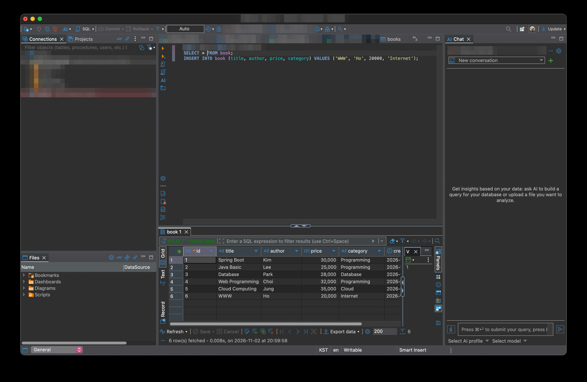

그 다음 movie_sql 테이블을 새로 만들었다.

```sql
CREATE TABLE movie_sql (
    id BIGINT AUTO_INCREMENT PRIMARY KEY,
    title VARCHAR(100) NOT NULL,
    director VARCHAR(100),
    genre VARCHAR(50),
    rating DOUBLE
);
```

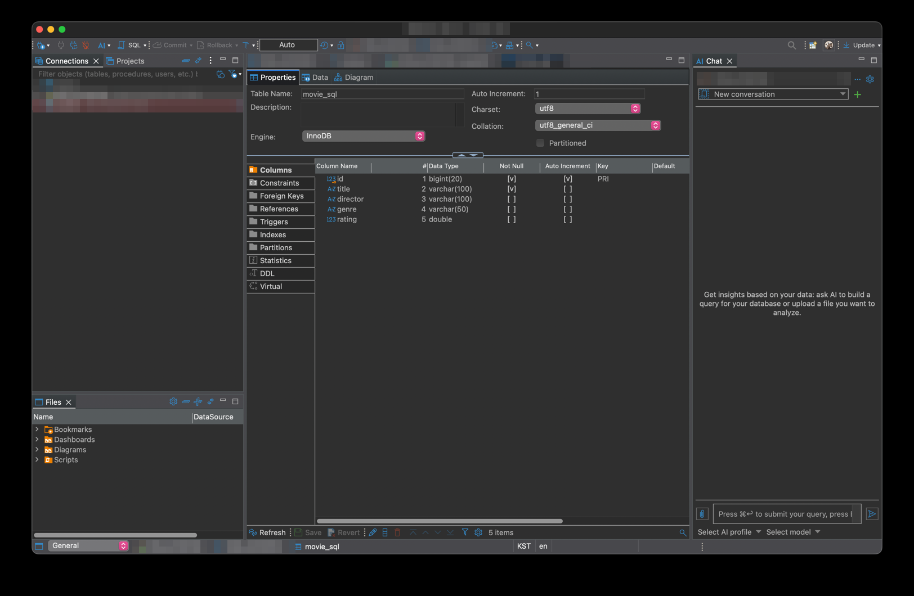

INSERT로 영화 3개를 넣었다. Parasite는 9.0으로 넣었는데 DBeaver에서는 9로 보였다.

```sql
INSERT INTO movie_sql(title, director, genre, rating)
VALUES ('Inception', 'Nolan', 'SF', 9.1), ('Interstellar', 'Nolan', 'SF', 9.3), ('Parasite', 'Bong', 'Drama', 9.0);
```

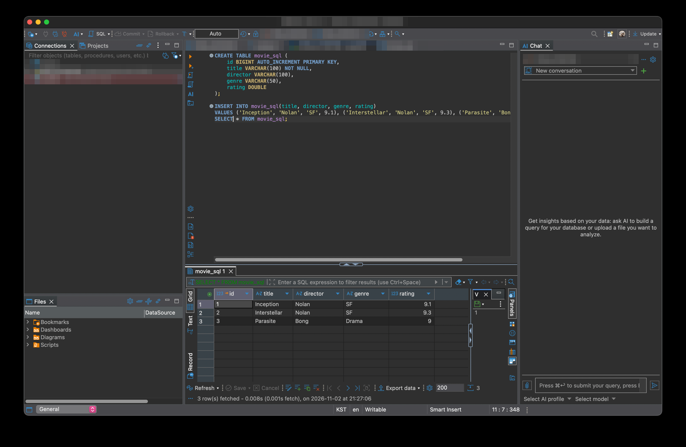

UPDATE로 Interstellar의 rating을 9.3에서 9.5로 바꿨다.

```sql
UPDATE movie_sql SET rating = 9.5 WHERE title = 'Interstellar';
```

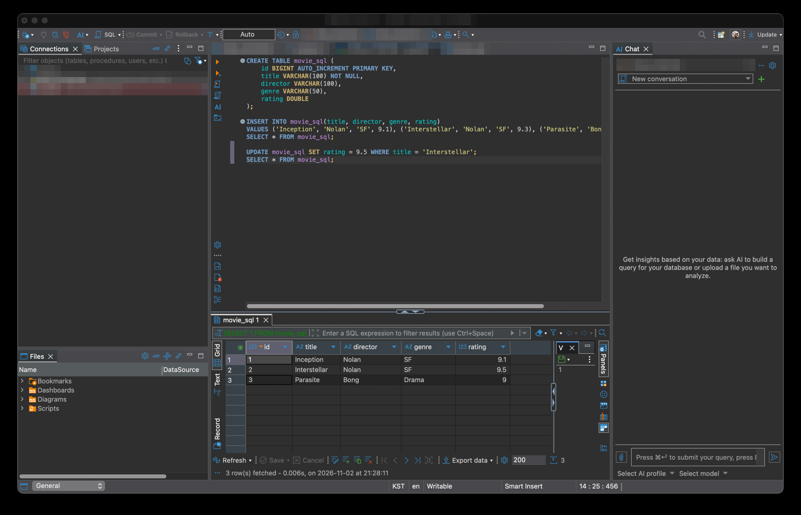

DELETE로 Parasite를 지웠고 2개가 남았다.

```sql
DELETE FROM movie_sql WHERE title = 'Parasite';
```

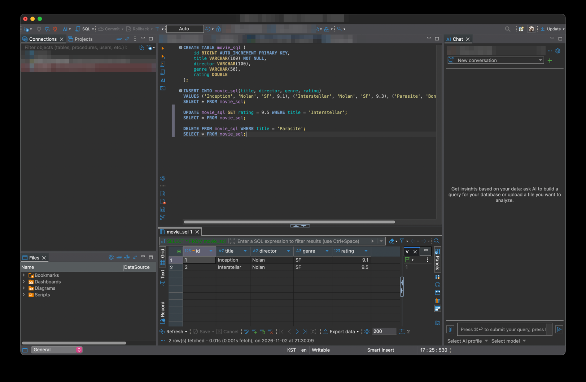

마지막으로 SELECT 3개를 실행했다. 전체 조회는 2행이 나왔고, title과 rating만 조회하면 컬럼 2개만 나왔다. genre = 'SF' 조건 조회도 2행이 나왔는데, Parasite를 지워서 남은 데이터가 전부 SF였기 때문에 전체 조회와 결과가 같았다.

```sql
SELECT * FROM movie_sql;
SELECT title, rating FROM movie_sql;
SELECT * FROM movie_sql WHERE genre = 'SF';
```

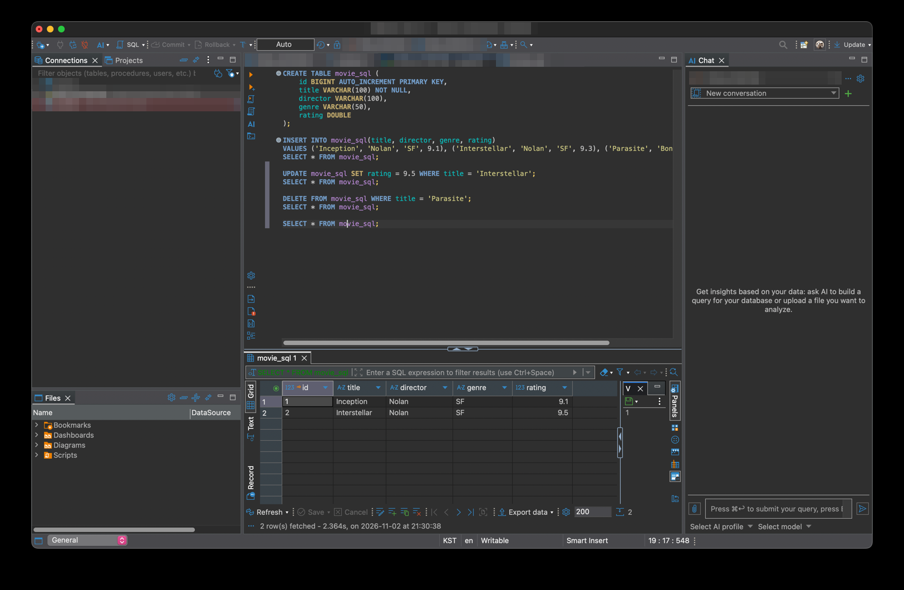
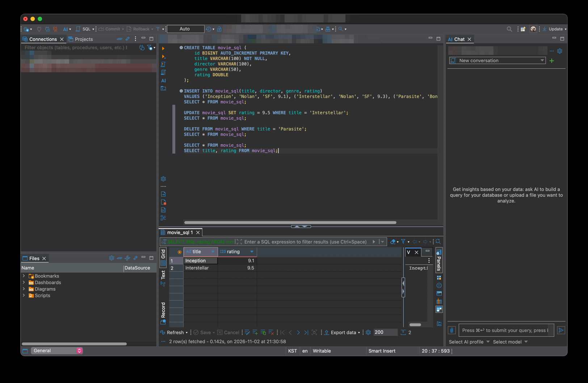
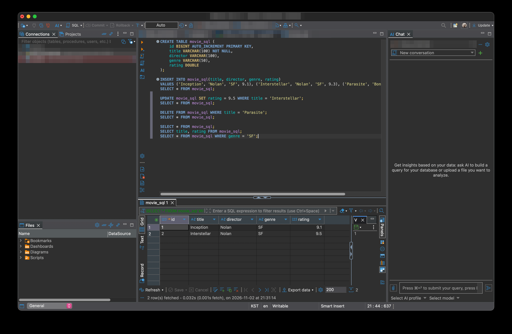

## 3. Spring Data JPA 구현

Repository는 JpaRepository<Hero, Long>을 상속하는 인터페이스만 만들었다. 메서드를 직접 작성하지 않아도 Spring Data JPA가 구현체를 만들어 줘서 save(), findAll(), findById(), deleteById(), existsById()를 바로 쓸 수 있었다.

```java
public interface HeroRepository extends JpaRepository<Hero, Long> { }
```

Entity에는 @Entity, @Table(name = "heroes"), @Id, @GeneratedValue(strategy = GenerationType.IDENTITY), @Column(nullable, length)을 사용했다. @Entity는 JPA가 관리하는 클래스라는 표시이고, @Table은 테이블 이름을 정한다. @Id는 기본키, @GeneratedValue의 IDENTITY는 MariaDB의 AUTO_INCREMENT를 쓰게 한다. @Column으로 NOT NULL과 varchar 길이를 정했다.

요청 DTO인 HeroRequest에는 @NotBlank, @NotNull, @Size, @PositiveOrZero를 붙였고, Controller에서 @Valid를 붙여서 검증이 실패하면 400이 나오게 했다. Controller는 @RestController와 @RequestMapping("/api/heroes")를, Service는 @Service를 사용했다.

API는 5개를 만들었다. POST /api/heroes는 등록(201), GET /api/heroes는 전체 조회(200), GET /api/heroes/{id}는 단건 조회(200, 없으면 404), PUT /api/heroes/{id}는 수정(200, 없으면 404), DELETE /api/heroes/{id}는 삭제(204, 없으면 404)이다.

요청 예시

```json
{
  "name": "Genji",
  "role": "Attack",
  "health": 250,
  "country": "Japan",
  "team": "Overwatch"
}
```

응답 예시 (201 Created)

```json
{
  "id": 1,
  "name": "Genji",
  "role": "Attack",
  "health": 250,
  "country": "Japan",
  "team": "Overwatch"
}
```

Spring Boot를 실행하니 heroes 테이블이 자동으로 만들어졌다. Long id는 bigint(20), Integer health는 int(11), length = 100인 String은 varchar(100), role은 varchar(50)이 되었고 nullable = false로 한 컬럼은 NOT NULL이 걸렸다. 코드에서는 name, role, health, country, team 순서로 썼는데 테이블은 id 다음에 country, health, name, role, team 순서(알파벳순)로 만들어졌다.

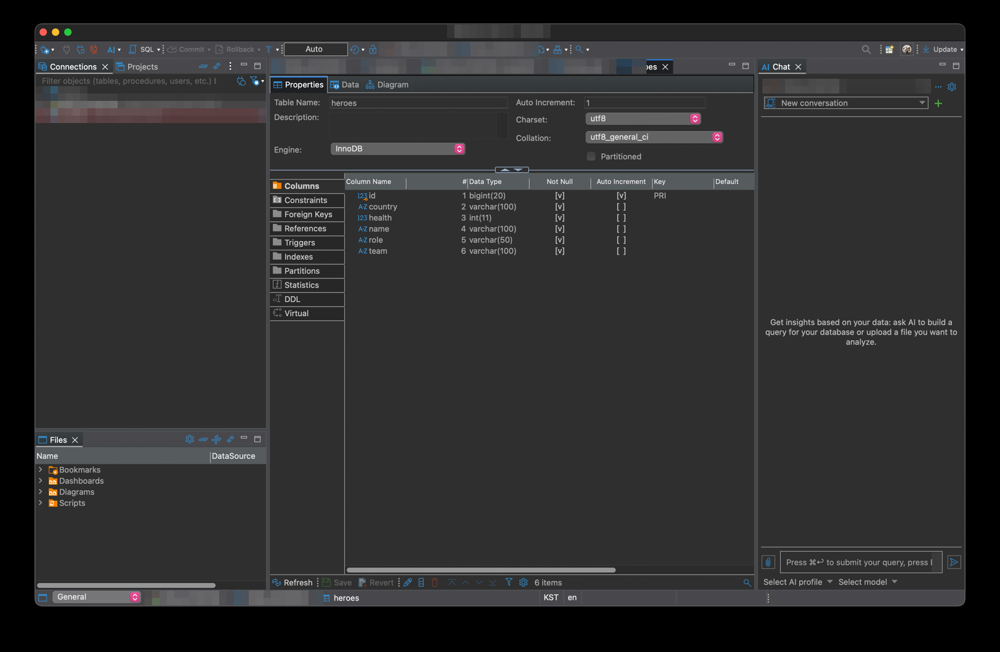

## 4. JPA와 SQL 비교

Postman으로 로컬에서 CRUD를 테스트했다. POST로 Genji를 등록하니 201과 함께 id 1이 나왔다.

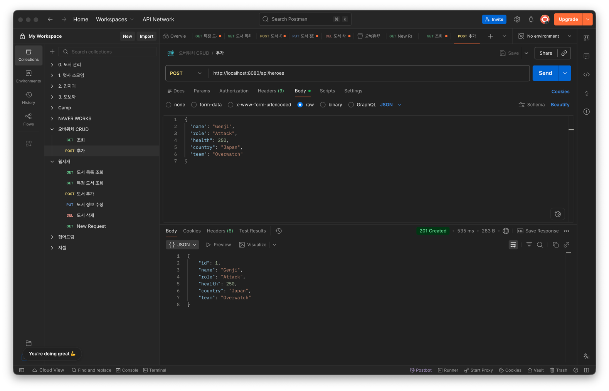

전체 조회와 단건 조회는 200이 나왔다.

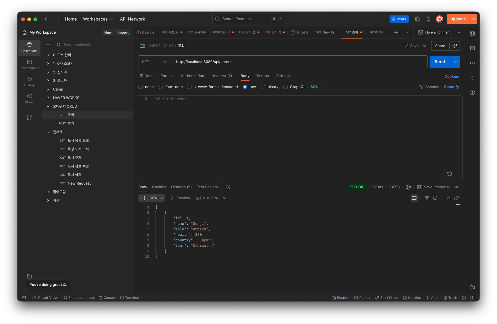
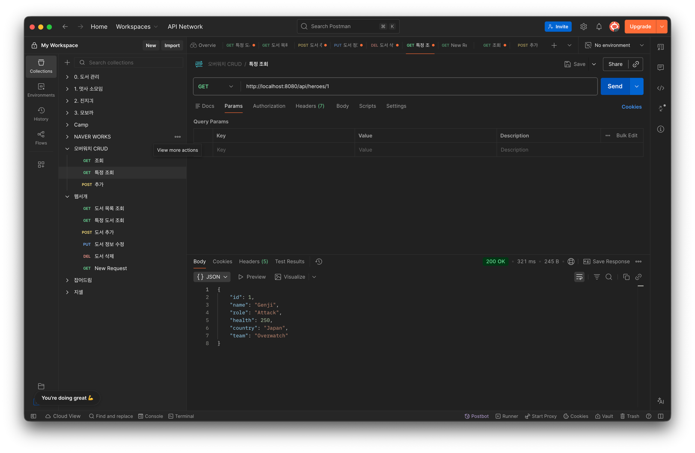

PUT으로 team을 Overwatch에서 Talon으로 바꾸고 다시 조회해서 바뀐 것을 확인했다.

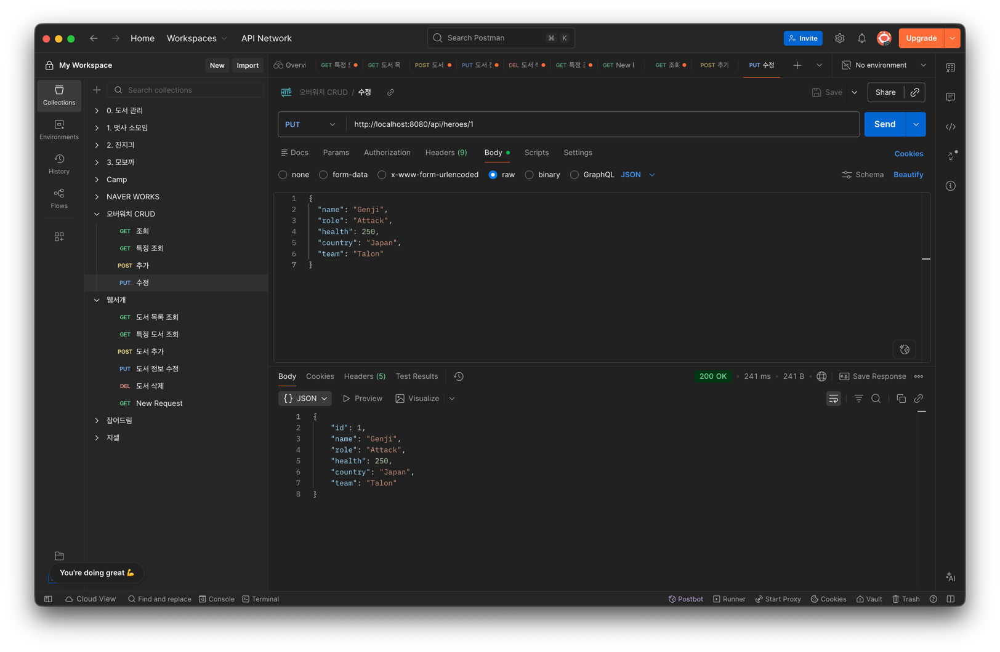
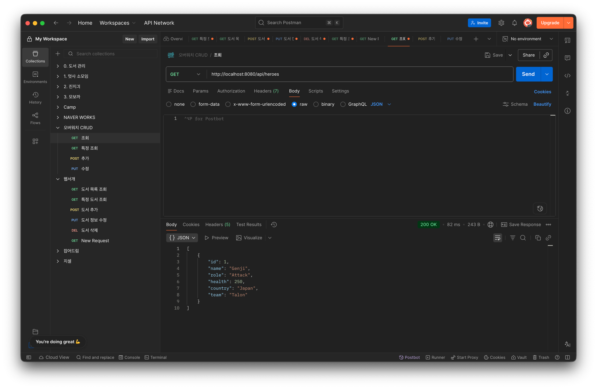

DELETE는 204가 나왔고, 다시 전체 조회하니 빈 배열이 나왔다.

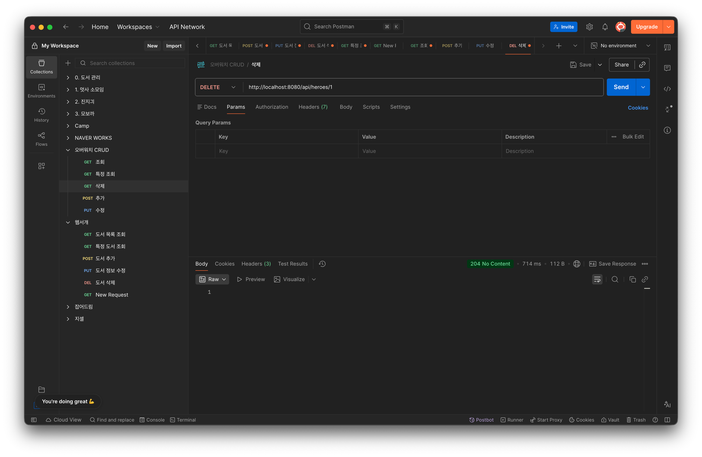
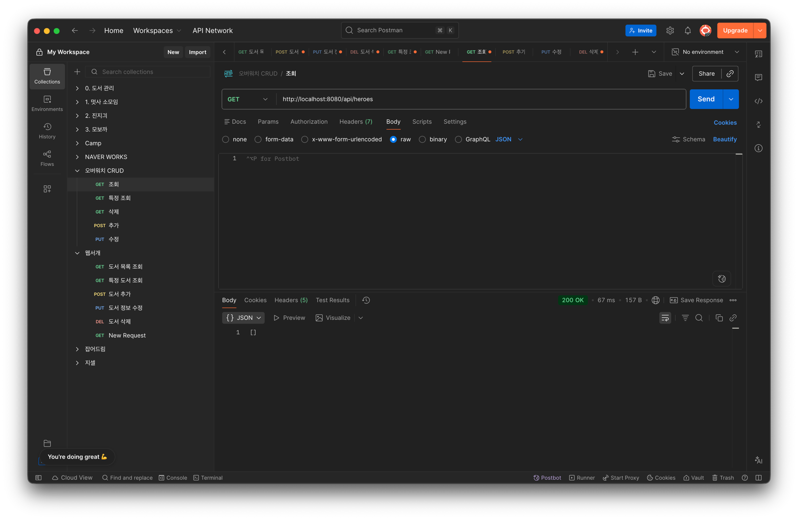

name을 빈 문자열로 보내면 400, 삭제한 id 1을 다시 조회하면 404가 나왔다.

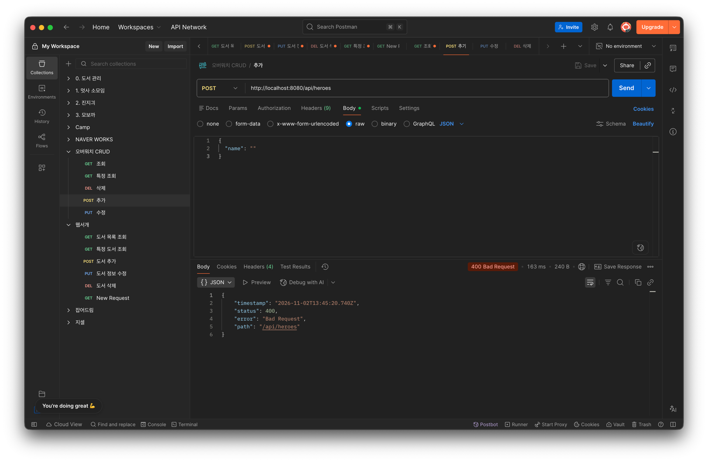
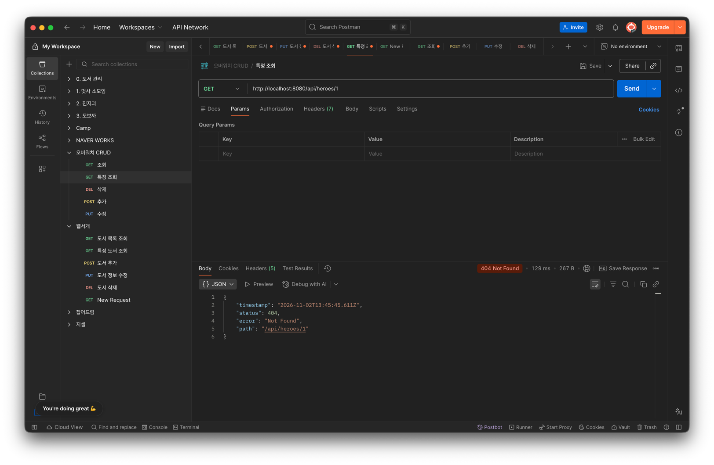

IntelliJ 콘솔에서 Hibernate가 만든 SQL을 확인했다. save()로 새 객체를 저장하면 insert into heroes (country, health, name, role, team) values (?, ?, ?, ?, ?)가 실행되고, findAll()은 select ... from heroes h1_0, findById()는 where h1_0.id=? 조건이 붙은 select가 실행됐다.

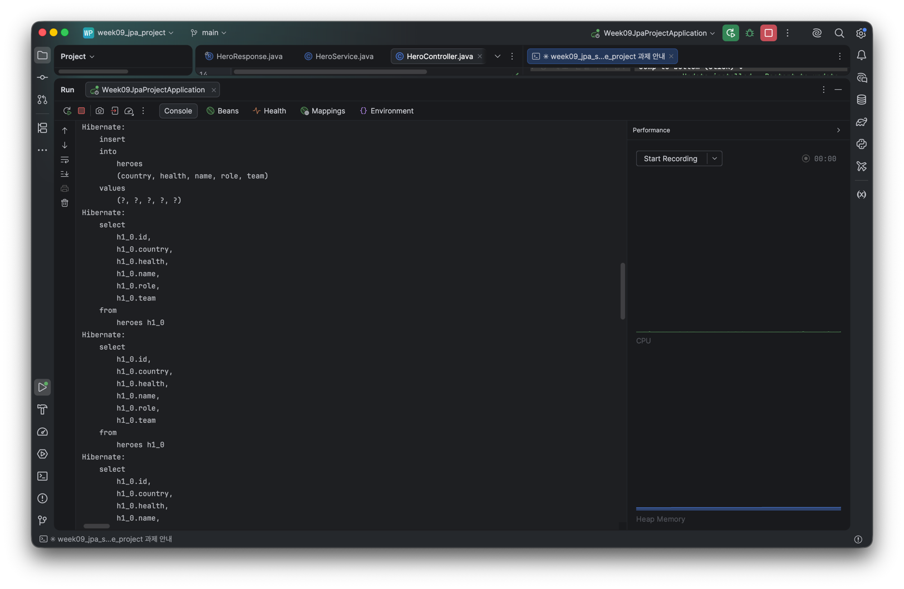

PUT /api/heroes/1을 한 번 보내면 select ... where h1_0.id=?가 2번, update heroes set country=?, health=?, name=?, role=?, team=? where id=?가 1번 실행됐다. Service에 @Transactional이 없어서 findById()로 가져온 객체는 메서드가 끝나면 영속성 컨텍스트에서 빠지고, save()를 호출하면 id가 있는 객체라서 merge가 되면서 DB에서 한 번 더 select한 다음 바뀐 값을 update했다. 같은 값으로 PUT을 한 번 더 보내니 select 2번만 나오고 update는 실행되지 않았다. 바뀐 값이 없으면 Hibernate가 update를 생략한다.

DELETE /api/heroes/1은 existsById()에서 select count(*) from heroes h1_0 where h1_0.id=?, deleteById()에서 select ... where h1_0.id=?와 delete from heroes where id=?가 실행돼서 SQL이 3번 나왔다. deleteById()는 바로 delete하지 않고 먼저 select로 객체를 찾은 다음 지운다. 없는 id를 DELETE하면 select count(*)만 실행되고 404가 나왔다.

SQL 실습에서는 CREATE, INSERT, UPDATE, DELETE를 직접 작성했지만 JPA에서는 ddl-auto=update로 테이블이 자동으로 만들어졌고, save() 같은 메서드를 호출하면 Hibernate가 SQL을 만들어서 실행했다. 값은 ? 파라미터로 바인딩된다.

JPA를 써 보니 SQL을 한 줄도 쓰지 않고 Repository 인터페이스 하나로 CRUD가 다 돼서 코드가 짧아졌고, 객체의 값만 바꾸면 update가 되는 점이 편했다. 컬럼 이름을 문자열로 쓰지 않으니 오타 걱정도 줄었다. 반대로 SQL이 눈에 보이지 않아서 실제로 어떤 쿼리가 몇 번 나가는지는 콘솔 로그를 봐야 알 수 있었고, PUT 한 번에 select가 2번이나 나가는 것처럼 직접 SQL을 쓸 때보다 쿼리가 더 많이 실행되는 경우도 있었다. 테이블 컬럼 순서도 내가 정한 대로 만들어지지 않았다. 그래서 JPA를 쓰더라도 show-sql로 실행되는 SQL을 확인하는 습관이 필요하다고 느꼈다.

## 5. 배포 및 환경 설정

DB 정보는 application.properties에 직접 쓰지 않고 환경변수로 받았다.

```properties
spring.datasource.url=${DB_URL}
spring.datasource.username=${DB_USERNAME}
spring.datasource.password=${DB_PASSWORD}
server.port=${PORT:8080}
```

IntelliJ에서는 Run → Edit Configurations → Environment variables에 DB_URL, DB_USERNAME, DB_PASSWORD를 등록했고, Render에서는 Environment에 같은 이름으로 등록했다. PORT는 Render가 자동으로 넣어 주기 때문에 따로 설정하지 않았다. .env와 .idea는 .gitignore에 넣어서 GitHub에 올라가지 않게 했다.

Dockerfile은 2단계로 만들었다. 첫 번째 단계(eclipse-temurin:17-jdk)에서 ./gradlew clean bootJar -x test로 jar를 만들고, 두 번째 단계(eclipse-temurin:17-jre)에는 jar만 복사해서 실행한다. 테스트(contextLoads)는 DB 연결이 필요해서 빌드할 때는 제외했다. .dockerignore로 .git, build, .idea, .env, images 같은 파일은 빌드에 포함되지 않게 했다.

Render 배포는 다음 순서로 했다.

1. Dockerfile과 .dockerignore를 커밋하고 GitHub에 push했다.
2. Render에서 New → Web Service를 누르고 GitHub 저장소를 연결했다.
3. Language는 Docker, Branch는 main으로 선택했다. Render가 저장소의 Dockerfile을 찾아서 이미지를 빌드한다.
4. Environment에 DB_URL, DB_USERNAME, DB_PASSWORD를 등록했다.
5. Deploy를 누르고 로그에서 Gradle 빌드와 Spring Boot 실행이 끝난 뒤 Your service is live가 나오는 것을 확인했다.
6. 발급된 주소 https://backend-jpa-project-hero.onrender.com 뒤에 /api/heroes를 붙여서 Postman으로 테스트했다.

배포 URL에서도 Postman으로 테스트했다. POST로 Tracer를 등록하니 201과 id 3이 나왔고, 전체 조회에서 Genji(id 2)와 Tracer(id 3)가 나왔다.

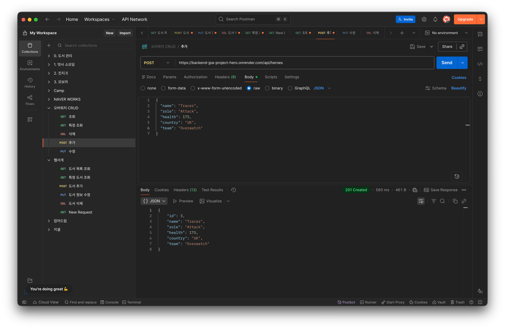
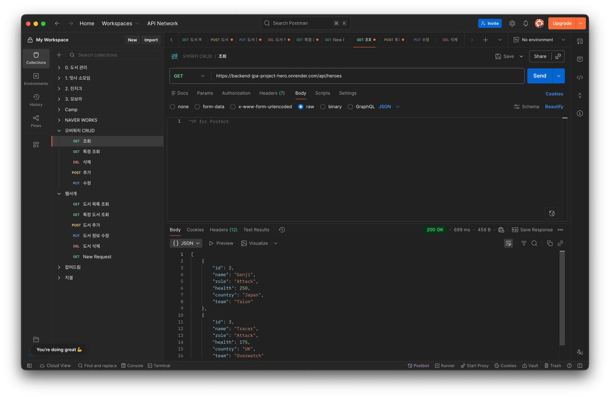

DBeaver에서 heroes 테이블을 조회해서 Render로 등록한 Tracer가 실제로 MariaDB에 저장된 것을 확인했다.

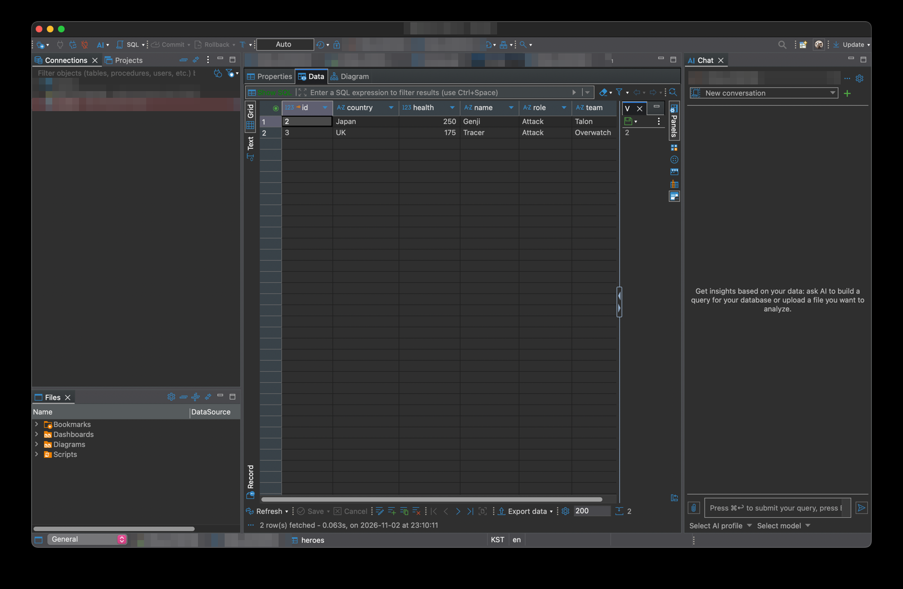

PUT /api/heroes/2로 Genji의 team을 Talon에서 UDT로 바꿨고, DELETE /api/heroes/2는 204가 나왔다. DBeaver에서 다시 조회하니 Tracer만 남아 있었다.

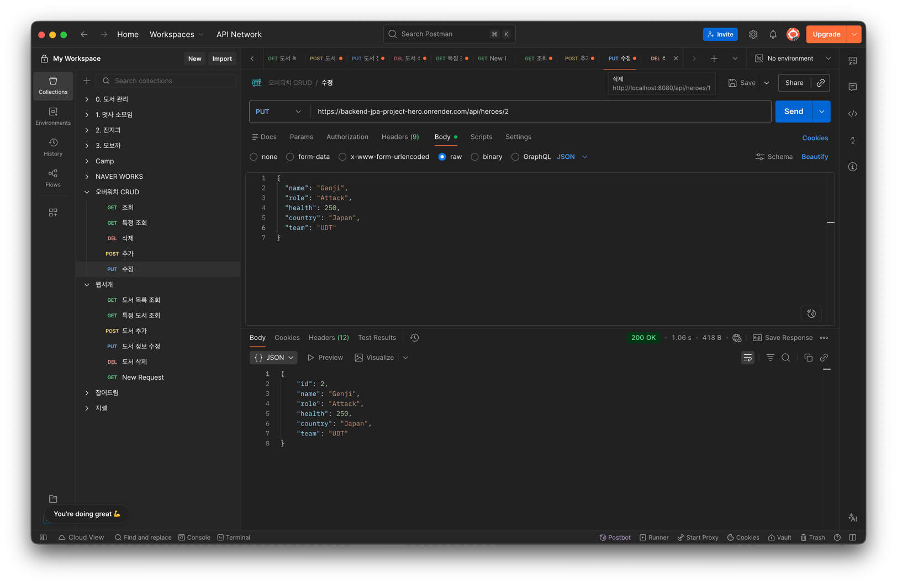
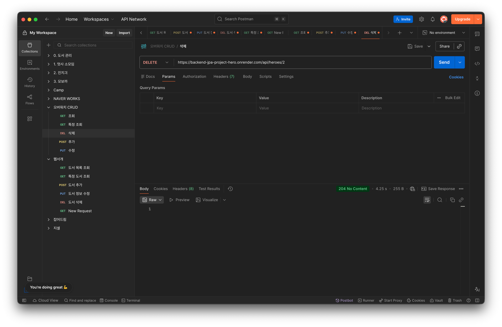


발생한 문제와 해결

Postman에서 POST를 보냈는데 404가 나왔다. URL 칸에는 /api/heroes로 되어 있었는데 응답의 path는 /api/heroes/로 끝에 슬래시가 붙어 있었다. Spring Boot 3부터는 끝에 슬래시가 붙은 주소를 다른 경로로 보기 때문에 404가 났다. 정확히 왜 슬래시가 붙었는지는 모르겠지만 요청을 새로 만들어서 보내니 해결됐다.

HeroRequest에 @NotBlank 같은 검증 어노테이션을 붙였는데 클래스를 찾지 못했다. spring-boot-starter-validation 의존성이 없어서였고, build.gradle에 추가하고 Gradle을 새로고침해서 해결했다.

@NotNull을 import할 때 IntelliJ가 org.antlr 패키지의 NotNull을 자동으로 골랐다. 검증 기능이 없는 클래스라서 jakarta.validation.constraints.NotNull로 바꿨다.

Hero와 HeroRepository에서 cannot find symbol 에러가 났는데, 다른 패키지에 있는 클래스를 import하지 않아서였다.

POST 응답의 Location 헤더가 /api/books/{id}로 되어 있었다. 샘플 코드를 가져오면서 경로를 안 바꿨던 것이라 /api/heroes/{id}로 수정했다.

Render 배포 중 생긴 문제는 없었다.

## 6. Weekly Report

Key Learning

- JpaRepository를 상속만 해도 save, findAll, findById, deleteById 같은 CRUD 메서드를 바로 쓸 수 있다.
- @Entity, @Id, @GeneratedValue, @Column으로 클래스를 테이블에 연결하고, ddl-auto=update로 테이블이 자동으로 만들어지는 것을 확인했다.
- JPA 메서드 하나가 SQL 하나와 같지 않다. PUT은 select 2번 + update 1번, DELETE는 select count + select + delete로 실행됐다.
- 요청 DTO에 검증 어노테이션을 붙이고 @Valid를 쓰면 잘못된 입력에 400을 돌려줄 수 있고, ResponseStatusException으로 없는 데이터에 404를 돌려줄 수 있다.
- DB 접속 정보를 환경변수로 빼면 코드를 바꾸지 않고 로컬(IntelliJ)과 Render에서 같은 코드를 실행할 수 있다.

Problem & Solution

- Postman POST 404: 요청 경로 끝에 슬래시가 붙어서(/api/heroes/) 매핑이 안 됐다. 요청을 새로 만들어서 해결했다.
- 검증 어노테이션을 찾지 못함: spring-boot-starter-validation 의존성을 build.gradle에 추가했다.
- @NotNull이 org.antlr 패키지로 import됨: jakarta.validation.constraints.NotNull로 바꿨다.
- cannot find symbol: 다른 패키지 클래스의 import를 추가했다.
- Location 헤더가 /api/books/{id}로 나옴: 샘플 코드의 경로를 /api/heroes/{id}로 고쳤다.

Code Review

```java
private Hero findEntity(Long id) {
    return repository.findById(id)
            .orElseThrow(() -> new ResponseStatusException(
                    HttpStatus.NOT_FOUND, "Hero not found: " + id));
}
```
찾는 영웅이 없을 때 예외처리를 통해 http 처리를 한다.

AI Usage

Claude(Claude Code)를 사용했다. 단계별 진행 순서와 힌트, 작성한 코드 리뷰와 컴파일 확인, build.gradle의 validation 의존성 추가, .dockerignore 작성, DBeaver 스크린샷 계정 정보 모자이크와 파일 이름 정리, Postman 테스트용 JSON, README 초안 작성(교수님 공지에 따라 AI 초안 작성 후 직접 수정)에 AI를 사용했다. DBeaver SQL 실습, Entity / DTO / Repository / Service / Controller 작성과 수정, 컴파일 에러 수정, Postman 테스트, Git 커밋, Render 배포는 직접 했다.

AI 사용률: 34 %

Reflection
직접 프론트엔드와 소통하는 것을 구현해보고싶다.
