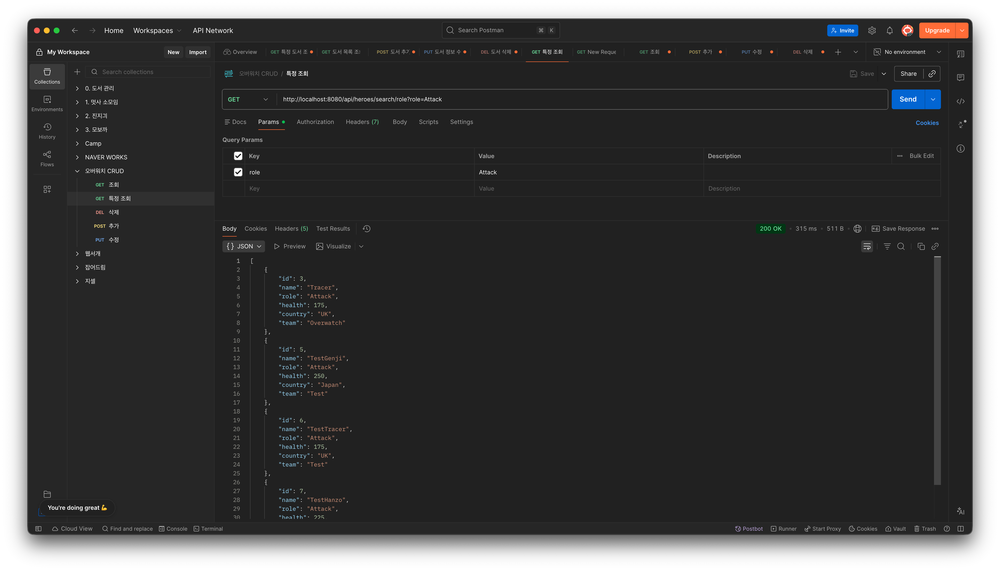
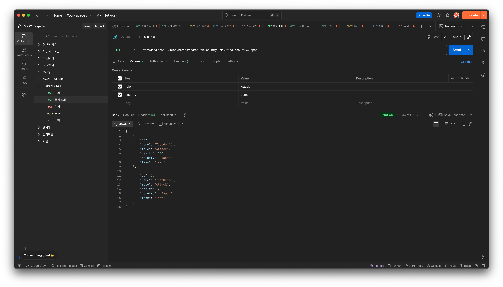
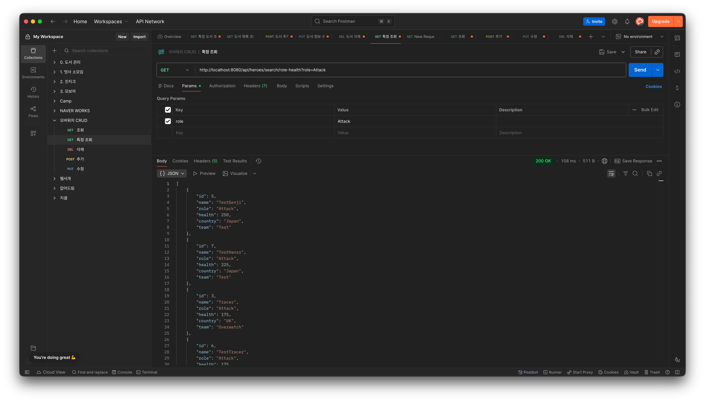
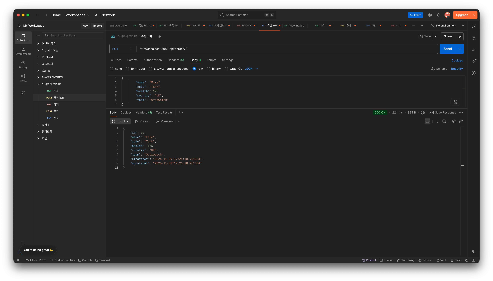
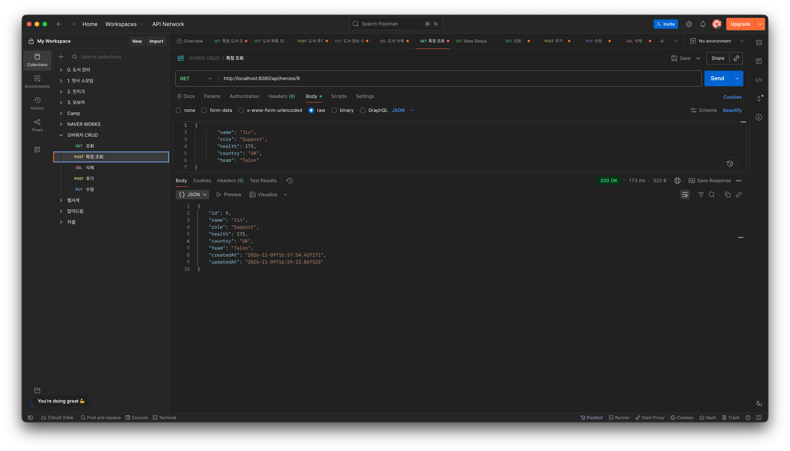
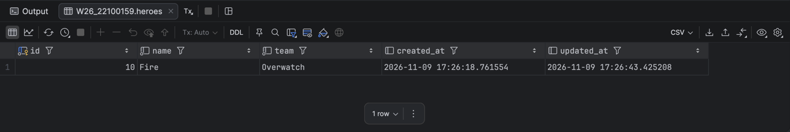

# Overwatch Heroes API (Week 10 JPA)
Spring Data JPA 응용 및 기능 확장

## 1. 프로젝트 소개
| 구분 | 링크 |
|---|---|
| GitHub Repository | [assign10-c01-22100159](https://github.com/2026-2-WebService/assign10-c01-22100159) |
| Render Deployment | [배포 서버](https://week10-hero-jpa-project.onrender.com) |
| API | [영웅 전체 조회](https://week10-hero-jpa-project.onrender.com/api/heroes) |

9주차에 만든 오버워치 영웅 CRUD API를 기반으로 검색과 정렬, Dirty Checking을 이용한 수정, Auditing을 이용한 생성·수정 시간 자동 기록 기능을 추가했다. Spring Data JPA로 MariaDB에 데이터를 저장하고 Render에 Docker로 배포했다.

Entity는 Hero이고 테이블 이름은 heroes이다. 기존 id, name, role, health, country, team 필드에 createdAt과 updatedAt을 추가했다. 요청에는 영웅 정보만 보내고, 날짜는 서버에서 자동으로 기록하도록 했다.

구조는 Controller → Service → JpaRepository → Hibernate → MariaDB 순서이다. 요청용 HeroRequest와 응답용 HeroResponse를 분리했고, 응답 DTO에 날짜 필드를 추가해서 Postman에서도 기록된 시간을 확인할 수 있게 했다.

개발에는 JDK 17, Gradle, Spring Boot, Spring Data JPA, MariaDB, IntelliJ, Postman, Docker, Render를 사용했다. 이번 작업에서는 IntelliJ의 Database 콘솔로 DB 구조를 확인하고 날짜 컬럼을 추가했다.

## 2. 주요 구현 내용 및 결과

### 2-1. Query Method 검색 및 정렬

HeroRepository에 Query Method 3개를 선언하고 Service와 Controller에 연결했다. 기존 CRUD API는 유지했다.

| Query Method | 검색 조건 | GET 요청 경로 |
|---|---|---|
| findByRole | 역할이 일치하는 영웅 | `/api/heroes/search/role?role=Attack` |
| findByRoleAndCountry | 역할과 국가가 모두 일치하는 영웅 | `/api/heroes/search/role-country?role=Attack&country=Japan` |
| findByRoleOrderByHealthDesc | 역할이 일치하는 영웅을 체력 내림차순으로 정렬 | `/api/heroes/search/role-health?role=Attack` |

Postman으로 세 검색 API를 호출하고 결과를 확인했다. 단일 조건 검색에서는 역할을, 복합 조건 검색에서는 역할과 국가를 함께 확인했다. 정렬 검색에서는 응답의 health 값이 큰 값부터 나오는지 확인했다.

실행 결과 (로컬 Postman)

**단일 조건 — 역할 검색**

`role=Attack`으로 요청하여 200 OK를 받았다. 응답에서 Tracer, TestGenji, TestTracer, TestHanzo의 role이 Attack인 것을 확인했다.



**복합 조건 — 역할과 국가 검색**

`role=Attack&country=Japan`으로 요청하여 200 OK를 받았다. 두 조건을 모두 만족하는 TestGenji와 TestHanzo가 조회됐다.



**정렬 — 역할별 체력 내림차순**

`role=Attack`으로 정렬 API를 호출하여 200 OK를 받았다. 응답에서 TestGenji(250), TestHanzo(225), Tracer(175), TestTracer(175) 순으로 체력이 내림차순인 것을 확인했다. 같은 체력끼리의 순서는 별도로 지정하지 않았다.



검색 결과가 여러 개일 수 있으므로 List로 반환했다. 첫 번째와 두 번째 검색은 정렬 조건이 없으므로 결과 순서를 기준으로 판단하지 않았다.

### 2-2. Dirty Checking을 이용한 수정

기존 수정 메서드는 엔티티 조회 후 값을 변경하고 repository.save()를 호출했다. 이번에는 수정 메서드에 @Transactional을 적용하고, 조회한 엔티티의 필드만 변경하도록 바꿨다. 수정 메서드에서 repository.save()를 호출하지 않는다.

Postman에서 PUT 요청으로 값을 변경하고 GET으로 다시 조회해서 수정 결과를 확인했다. PUT 응답만 보는 대신 다시 조회해서 저장 여부를 확인했다.

- 수정 대상: ID 10, Fire
- 변경한 값: team을 `Talon`에서 `Overwatch`로 변경
- PUT `/api/heroes/10`: 200 OK, 응답의 team이 Overwatch로 변경됨
- GET `/api/heroes/10` 재조회: 200 OK, team이 Overwatch로 유지됨
- DB 확인 결과는 아래 Auditing 항목의 통합 조회 결과에 함께 정리한다.




### 2-3. Auditing을 이용한 시간 자동 기록

@EnableJpaAuditing으로 기능을 활성화하고 Hero에 AuditingEntityListener를 등록했다. createdAt에는 @CreatedDate, updatedAt에는 @LastModifiedDate를 적용했다. createdAt에는 updatable = false도 설정했다.

새 영웅을 등록할 때 요청 JSON에는 날짜를 보내지 않았다. 등록 후 생성 시간과 수정 시간이 자동으로 기록되는지 확인했고, 기존 데이터를 수정한 뒤 다시 조회해서 생성 시간은 유지되고 수정 시간은 변경되는지 확인했다.

ID 10(Fire)의 등록 및 수정 후 조회 결과는 다음과 같다. 아래 캡처는 로컬 서버에서 실행한 결과이다.

| 확인 시점 | createdAt | updatedAt |
|---|---|---|
| POST 등록 후 (201 Created) | 2026-11-09T17:26:18.761554 | 2026-11-09T17:26:18.761554 |
| PUT 후 GET 재조회 (200 OK) | 2026-11-09T17:26:18.761554 | 2026-11-09T17:26:43.425208 |

날짜를 포함하지 않은 등록 요청에서도 두 시간이 자동으로 기록됐다. team을 변경한 뒤 재조회하니 생성 시간은 유지되고 수정 시간만 변경됐다.


수정 후 응답은 위의 GET 재조회 캡처에서 확인할 수 있다.

추가로 ID 9(Jin)의 GET 응답에서도 생성 시간과 이후 수정 시간이 기록된 것을 확인했다.



**DB 조회 결과 — Dirty Checking·Auditing 통합 확인**

```sql
SELECT id, name, team, created_at, updated_at
FROM heroes
WHERE id = 10;
```



DB에서 ID 10(Fire)의 team이 Overwatch로 저장된 것을 확인했다. created_at은 등록 시각인 2026-11-09 17:26:18.761554로 유지됐고, updated_at은 2026-11-09 17:26:43.425208로 변경됐다. DB 조회 결과가 Postman의 수정 후 GET 응답과 일치했다.

기존 데이터의 생성 시간은 컬럼을 추가했다고 과거 시점으로 자동 기록되지 않으므로, Auditing 검증에는 새로 등록한 데이터를 사용했다. 현재 수정 메서드는 커밋 전에 응답 DTO를 만들기 때문에 PUT 응답의 수정 시간이 이전 값일 수 있어, 수정 후 GET으로 다시 조회한 값을 기준으로 확인했다.

### 2-4. 배포 서버 실행 결과

Render에 Docker로 배포한 후 배포 URL에서 API를 테스트했다. DB 연결 정보는 환경변수로 설정했다.

| 검증 항목 | 실행 결과 |
|---|---|
| 기존 CRUD | 배포 서버에서 영웅 등록, 전체·단건 조회, 수정, 삭제 요청이 정상 동작하는 것을 확인했다. |
| 검색 및 정렬 | 역할 검색과 역할+국가 검색에서 조건에 맞는 영웅이 조회됐다. 체력 정렬 검색에서는 health가 내림차순으로 반환됐다. |
| Dirty Checking | PUT으로 team을 변경한 뒤 GET으로 다시 조회하여 변경된 값이 저장된 것을 확인했다. |
| Auditing | 날짜를 보내지 않고 등록해도 생성·수정 시간이 기록됐다. 값을 수정한 뒤 GET으로 조회하니 생성 시간은 유지되고 수정 시간만 변경됐다. |

## 3. Weekly Review

### Key Learning

- Query Method의 이름에 엔티티 필드와 And, OrderBy, Desc 등을 조합하면 조건 검색과 정렬을 구현할 수 있다는 것을 배웠다.
- 트랜잭션 안에서 조회한 엔티티는 변경 감지의 대상이 되므로, 필드를 바꾼 후 save()를 다시 호출하지 않아도 수정 사항을 반영할 수 있다는 것을 배웠다.
- Auditing으로 시간을 자동 기록할 수 있지만, Entity에 필드를 추가하는 것과 실제 DB 컬럼이 준비되는 것은 함께 확인해야 한다는 것을 배웠다.

### Problem & Solution

- POST 요청에서 400이 발생했다. 객체 하나를 받는 API에 이중 배열로 데이터를 보낸 것이 원인이었고, JSON 객체 하나만 보내도록 수정해서 해결했다.
- Entity에 날짜 필드를 추가한 후 INSERT에서 Unknown column 'created_at' 오류가 발생했다. 실제 heroes 테이블에 날짜 컬럼이 없어서 IntelliJ의 Database 콘솔에서 created_at과 updated_at을 추가한 뒤 다시 등록했다. ddl-auto=update 설정이 있었지만 자동 변경이 반영되지 않은 정확한 원인까지는 확인하지 못했다.
- 수정 작업 중 검색용 Service 메서드 3개가 파일에서 사라진 것을 확인하고 복원했다. 이후 검색 메서드와 Dirty Checking 수정 코드가 함께 유지되는지 확인했다.
- Render 빌드에서 Gradle 다운로드 타임아웃이 발생했다. 다운로드 대기 시간을 60초로 늘리고 다시 배포했다.

### Reflection

save()를 호출해야만 수정 내용이 저장된다고 생각했는데, 트랜잭션 안에서 조회한 객체의 값을 바꾸는 것만으로 DB에 반영되는 것을 확인하면서 JPA의 동작을 조금 더 이해할 수 있었다. 날짜 필드를 추가했을 때 실제 DB에는 컬럼이 없어 오류가 난 경험을 통해, 코드뿐 아니라 테이블 구조와 저장된 값까지 확인하는 것이 중요하다고 느꼈다. 다음에는 트랜잭션 도중 예외가 발생했을 때 변경 사항이 어떻게 롤백되는지도 직접 테스트해 보고 싶다.

## 4. AI Usage

### 사용 도구 및 주요 질문

ChatGPT(Codex)를 사용했다. JPA 어노테이션과 JpaRepository 메서드의 의미, Query Method 작성 방법, @Transactional과 Dirty Checking의 관계, Auditing 설정 방법을 질문했다. AI가 코드 예시와 주석 설명을 제시했고, 작성한 파일을 읽어 검토하는 도움을 받았다. POST 400 오류, 날짜 컬럼 누락 오류, Render의 Gradle 다운로드 타임아웃 원인 분석과 README 초안 작성에도 활용했다.

### 직접 수정하거나 검증한 부분

제시된 코드를 직접 프로젝트에 입력하고 수정했으며, Postman 요청과 DB 작업, Git 커밋, Render 배포 및 배포 서버 테스트는 직접 진행했다. 직접 입력한 부분이라도 AI가 제공한 코드 예시와 설명을 활용한 범위는 AI 사용에 포함한다.

- AI가 제시한 검색 메서드를 Hero의 role, country, health 필드에 맞춰 프로젝트에 추가하고 Service와 Controller에 연결했다. Postman에서 역할 검색, 역할+국가 검색, 체력 내림차순 결과를 확인했다.
- 수정 메서드에 @Transactional을 적용하고 repository.save() 호출을 제거했다. ID 10의 team을 Talon에서 Overwatch로 변경한 뒤 GET 재조회와 DB 조회로 저장된 값을 확인했다.
- Auditing 설정과 날짜 필드, 응답 DTO를 추가했다. 날짜를 보내지 않고 등록한 뒤 수정해 보면서 createdAt이 유지되고 updatedAt만 변경되는 것을 확인했고, DB 컬럼의 값도 응답과 대조했다.
- POST 요청을 이중 배열에서 객체 하나로 수정해 400 오류를 해결했다. 날짜 컬럼 누락 오류는 DB에 컬럼을 추가해 해결했고, Gradle 다운로드 제한 시간을 60초로 변경한 뒤 Render 재배포와 API 테스트를 진행했다.

### AI 사용 비율에 대한 자기 평가

- AI 사용률: 38%
- 주석 설명과 오류 해결을 위해 AI를 사용하여 공부를 하고 이해한 바를 작성하였다.